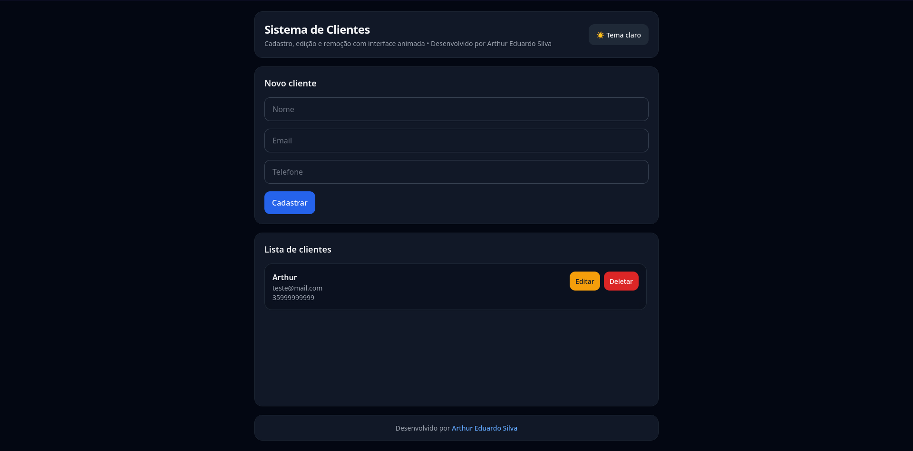

# 🚀 CRUD de Clientes (Supabase + React)

Aplicação web para gerenciamento de clientes utilizando **Supabase como backend (BaaS)** e frontend moderno com React.

---

## 🌐 Acesse o projeto

👉 https://clientes-arthur.vercel.app/

---

## 📸 Preview



---

## 🧠 Arquitetura

Este projeto utiliza uma abordagem moderna baseada em **Backend as a Service (BaaS)**:

* Frontend → React (Vercel)
* Backend → Supabase (API + Banco de dados)
* Backend auxiliar → Laravel (estrutura local para modelagem e testes)

---

## ✨ Funcionalidades

* ➕ Cadastro de clientes
* 📋 Listagem de clientes
* ✏️ Atualização de dados
* ❌ Remoção de clientes
* 🔍 Validação de campos
* 🔔 Feedback visual (sucesso/erro)
* ⏳ Estados de loading
* 📱 Interface responsiva

---

## 🛠️ Tecnologias

* React
* TypeScript
* TailwindCSS
* Supabase (API + Database)
* Axios

---

## ⚙️ Como rodar localmente

```bash id="f1a2b3"
git clone https://github.com/Arthss/crud-clientes-frontend
cd crud-clientes-frontend
npm install
npm run dev
```

---

## 🔌 Configuração do Supabase

Crie um `.env`:

```env id="supabase1"
VITE_SUPABASE_URL=YOUR_SUPABASE_URL
VITE_SUPABASE_ANON_KEY=YOUR_SUPABASE_KEY
```

---

## 🎯 Objetivo

Este projeto foi desenvolvido para demonstrar:

* Integração com APIs modernas (BaaS)
* Arquitetura desacoplada
* Boas práticas de frontend
* Experiência do usuário

---

## 👨‍💻 Autor

Arthur Eduardo Silva
https://github.com/Arthss
